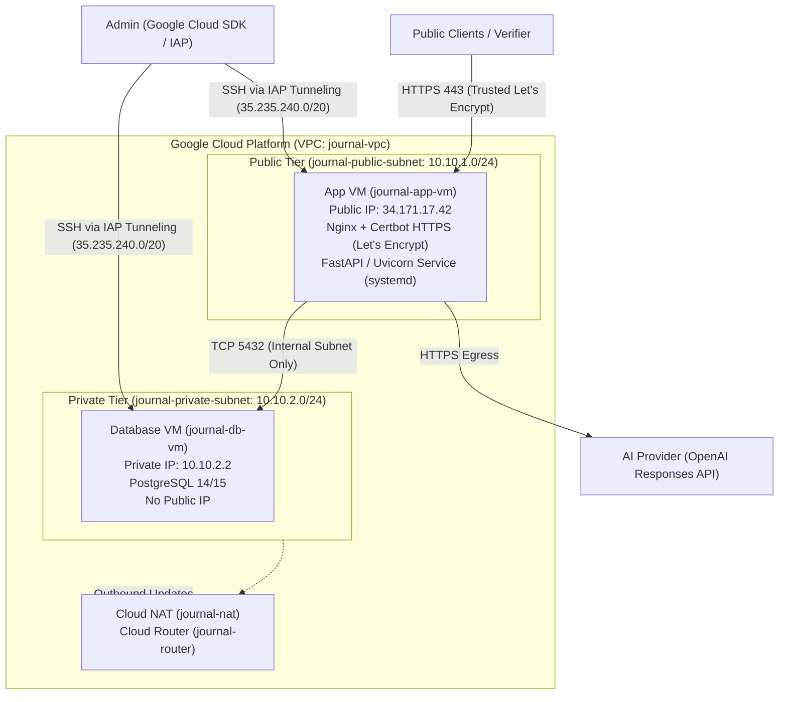
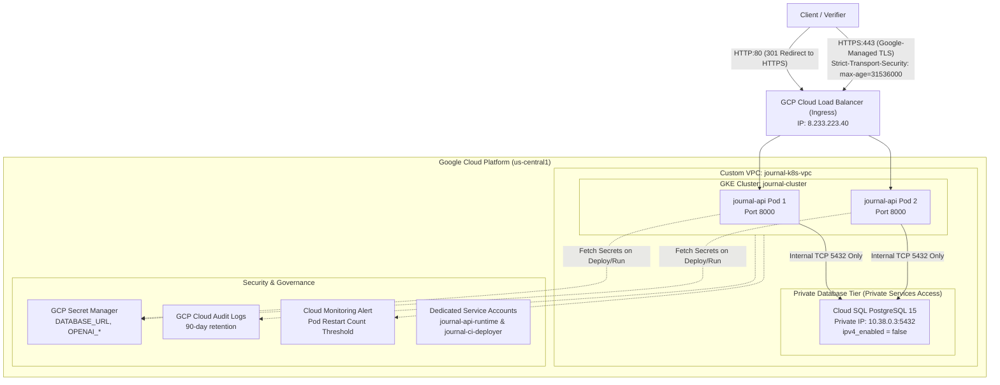

# Learn to Cloud Phase 3 Capstone: Journal API

[](https://github.com/githukueliud/journal-starter/actions/workflows/ci.yml)

Welcome to [Learn to Cloud's](https://learntocloud.com) Phase 3 capstone. You will be guided to building a journal API with **FastAPI**, **PostgreSQL**, structured logging, input validation, and AI-powered entry analysis.

## Capstone

These chapters will guide you and are meant to be completed in order. Each chapter builds on the previous one, so do not skip ahead. 

1. [Check the prerequisites](docs/01-prerequisites.md)
2. [Set up the project](docs/02-project-setup.md)
3. [Run the API](docs/03-run-the-api.md)
4. [Build GET for one entry](docs/04-get-entry.md)
5. [Build DELETE for one entry](docs/05-delete-entry.md)
6. [Add input validation and debug a partial update](docs/06-input-validation.md)
7. [Use logs to understand the API](docs/07-logging.md)
8. [Set up an AI provider](docs/08-ai-setup.md)
9. [Build AI-powered analysis](docs/09-ai-analysis.md)
10. [Finish the capstone](docs/10-finish.md)

**[Start the capstone →](docs/01-prerequisites.md)**

## Reference

This is additional reference material for the capstone in case you want to explore further or need help:

- [Testing and CI](docs/reference/testing-and-ci.md)
- [Troubleshooting](docs/reference/troubleshooting.md)
- [Sync your fork with upstream](docs/reference/upstream-sync.md)
- [Explore your database](docs/reference/explore-database.md)

> **Learning environment only:** This application has no authentication or
> per-user data isolation. Do not expose it publicly or store personal or
> sensitive journal content in it.

## Deployment Architecture & Evidence (Phase 4 Capstone)

### 1. Architecture Diagram



### 2. Selected Services & Deployment Controls

- **Cloud Provider:** Google Cloud Platform (GCP)
- **Deployment Tool:** HashiCorp Terraform (`deploy/terraform/main.tf`)
- **Compute Tier:**
  - `journal-app-vm` (`e2-micro`, Ubuntu 22.04 LTS): Hosts Nginx reverse proxy, Certbot SSL certificate manager, and the FastAPI Uvicorn service under systemd.
  - `journal-db-vm` (`e2-micro`, Ubuntu 22.04 LTS): Hosts standalone PostgreSQL. Has **no external IP address** and resides purely in the private subnet.
- **Networking & Access Controls:**
  - **Custom VPC (`journal-vpc`):** Separated into `journal-public-subnet` (`10.10.1.0/24`) and `journal-private-subnet` (`10.10.2.0/24`).
  - **Firewall Rules:**
    - `journal-allow-http-https`: Allows ingress on ports 80 and 443 from `0.0.0.0/0` to `journal-app` only.
    - `journal-allow-app-to-db`: Restricts port 5432 ingress on `journal-db` strictly to source range `10.10.1.0/24`. Direct internet access to the database is completely blocked.
    - `journal-allow-ssh-admin`: Restricts SSH (port 22) exclusively to Google Cloud Identity-Aware Proxy (`35.235.240.0/20`), requiring authenticated IAM credentials.
- **AI Model & Safety Controls:**
  - **Model:** `openai/gpt-4o-mini` accessed via standard OpenAI Responses API format with strict JSON Schema constraints (`sentiment`, `summary`, and `topics` minItems: 2, maxItems: 4).
  - Credentials injected securely through environment files, excluded from source control and logs.
- **Estimated Cost:**
  - 2x `e2-micro` instances: ~$0.01 - $0.02 per hour (Free Tier eligible).
  - Cloud NAT + Static IP: ~$0.01 per hour.
  - Budget alert threshold configured in GCP Billing console.

### 3. Verification & Deployment Evidence

- **Public HTTPS Base URL:** `https://34.171.17.42.sslip.io`
- **Certificate Authority:** Let's Encrypt (Trusted SSL Certificate, valid through 2027-02-18)
- **Constraint Demonstration:**
  1. **Public HTTPS:** `curl -i https://34.171.17.42.sslip.io/docs` returns HTTP `200 OK` over TLS.
  2. **Database Isolation:** Database accepts connections from `10.10.1.0/24` only. Direct connection attempts from the public internet time out (`nc -zv -w 3 10.10.2.2 5432` / `nc -zv -w 3 34.171.17.42 5432` timed out).
  3. **Private Management:** Port 22 is closed to the public internet; admin access uses authenticated GCP IAP tunnels.
  4. **Persistence & Reliability:** Application is managed by `systemd` (`journal-api.service`) with `Restart=always`; PostgreSQL persists state to disk across restarts.
  5. **Functional API & Live AI:**
     - `POST /entries` created entry `13300e9f-1ed1-48fb-b957-036a6d9bd582` with status `200`.
     - `POST /entries/13300e9f-1ed1-48fb-b957-036a6d9bd582/analyze` returned sentiment (`positive`), summary, and 4 topics within < 6 seconds.

### 4. Production Limitation & Next Steps

- **Limitation:** Lack of user authentication and data isolation. Every client accessing `https://8.233.223.40.sslip.io/entries` shares a single global journal store without per-user tenancy or role-based access control.
- **Production Solution:** Implement OAuth2 / JWT authentication (e.g. Firebase Auth, Auth0, or Cognito) and associate all journal records with an authenticated `user_id` column with row-level security.

---

## Phase 5 & 6: DevOps & Security Hardening Deployment

### 1. Architecture Overview



### 2. Security Hardening Controls Implemented (Phase 6)

1. **Dedicated Service Accounts & Minimal Privilege:**
   - App runtime and CI/CD use dedicated non-personal service accounts (`journal-api-runtime@kenya-one-505921.iam.gserviceaccount.com` and `journal-ci-deployer@...`).
   - Permissions strictly scoped to `roles/secretmanager.secretAccessor` and `roles/cloudsql.client`.
2. **Managed Secrets in GCP Secret Manager:**
   - `DATABASE_URL`, `OPENAI_API_KEY`, `OPENAI_BASE_URL`, and `OPENAI_MODEL` stored exclusively in GCP Secret Manager.
   - Zero plaintext credentials or `.env` files stored in source control or committed manifests.
3. **Private Database Tier:**
   - Cloud SQL instance `journal-pg-7ca9543b` operates with `ipv4_enabled = false` and connects solely via Private Services Access (`10.38.0.3`). Public internet connections are impossible.
4. **Enforced HTTPS & HSTS:**
   - GKE Ingress FrontendConfig automatically issues HTTP `301 Moved Permanently` redirects for plaintext traffic on port 80.
   - FastAPI application injects `Strict-Transport-Security: max-age=31536000; includeSubDomains`, `X-Content-Type-Options: nosniff`, and `X-Frame-Options: DENY` headers on all responses.
5. **Cloud Audit Logging:**
   - Audit logging enabled across Cloud IAM, GKE, and Cloud SQL with a configured 90-day retention policy (`_Default` log bucket).
6. **Cloud Monitoring Security Alerts:**
   - Automated alert policy configured for container restart anomalies (`kubernetes.io/container/restart_count > 2` over 10m) notifying administrators.
7. **CodeQL Automated Vulnerability Scanning:**
   - GitHub Actions workflow (`.github/workflows/codeql.yml`) executes automated AST-based security analysis (`security-and-quality` suite) on every push and weekly schedule.

### 3. Production Verification Evidence

- **Public Endpoint:** `https://8.233.223.40.sslip.io`
- **Current Main Commit:** `4419924dd69a215f397960aba9b77276225fe20b`
- **GET /version Response:**
  ```json
  {"commit": "4419924dd69a215f397960aba9b77276225fe20b"}
  ```
- **HSTS Header Verification:**
  ```http
  strict-transport-security: max-age=31536000; includeSubDomains
  ```
- **HTTP Block/Redirect:**
  ```http
  HTTP/1.1 301 Moved Permanently
  Location: https://8.233.223.40.sslip.io:443/version
  ```

## License

MIT License - see [LICENSE](LICENSE).
